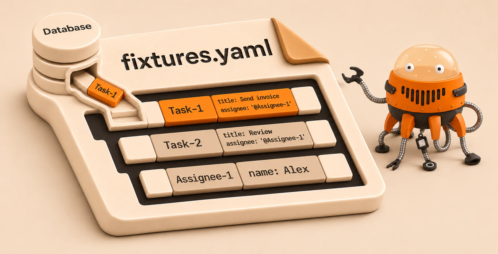

# AliceGenerator

[](https://packagist.org/packages/solitus0/alice-generator) [](LICENSE)

AliceGenerator is a PHP 8.1+ library that exports existing objects, including Doctrine entities, as reusable Alice fixtures.
It preserves shared objects and cycles as named references in the generated YAML.

Generating fixtures from records created through your application's workflows saves time and gives you realistic test data that reflects your business rules and preserves relationships between records.



## Quick start

```sh
composer require solitus0/alice-generator --dev
```

Run the [PHP quick start](./docs/getting-started.md#quick-start) to export two tasks that share one assignee.
The YAML groups fixtures by fully qualified class name, and both tasks reference the same assignee fixture.

```yaml
App\Entity\Assignee:
    Assignee-1:
        name: Alex
App\Entity\Task:
    Task-1:
        title: 'Send invoice'
        assignee: '@Assignee-1'
    Task-2:
        title: Review
        assignee: '@Assignee-1'
```

## Documentation

- [Usage](./docs/usage.md) covers recursion, object constraints, and collection filters.
- [Configuration](./docs/configuration.md) covers Doctrine, naming, how fixtures are written, and output formats.
- [Property transformers](./docs/property-transformers.md) replace or redact field values.
- [Custom object handlers](./docs/custom-object-handlers.md) support value objects that need custom serialization.
- [Recipe-based export](./docs/fixture-export.md) selects records and fields and validates the YAML before writing it.
- [Changelog](./CHANGELOG.md) lists features and migration notes by release.

AliceGenerator is an independently maintained fork of [trappar/AliceGenerator](https://github.com/trappar/AliceGenerator).
It is released under the [MIT License](LICENSE).
