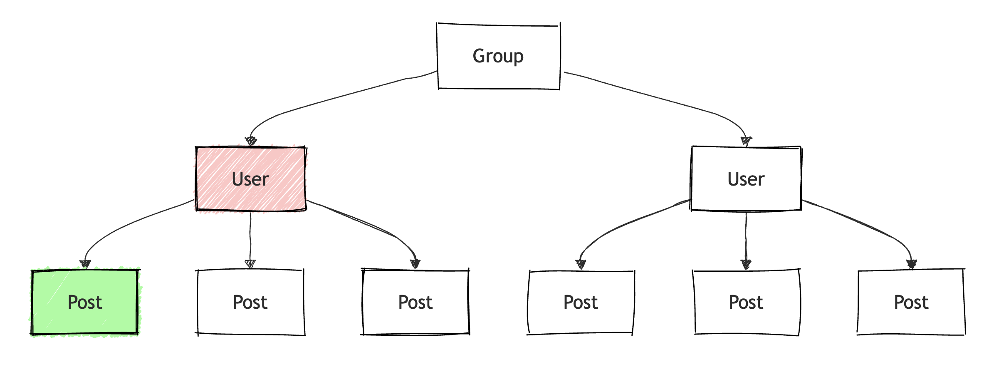
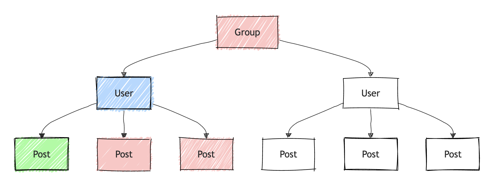
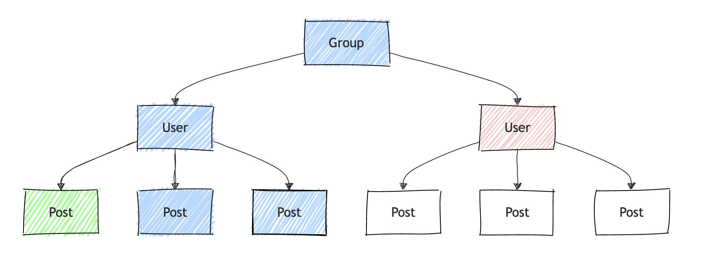
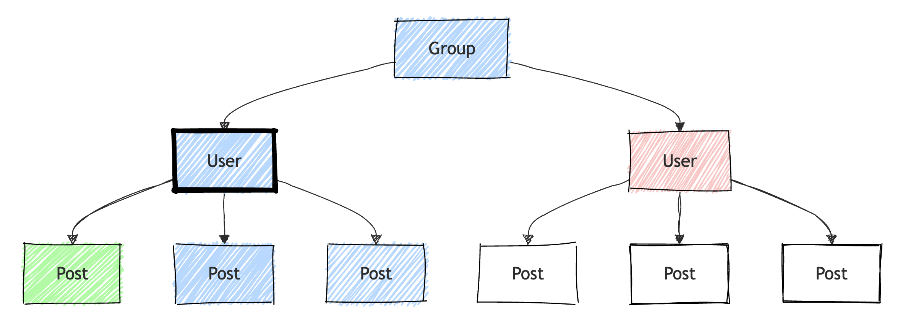
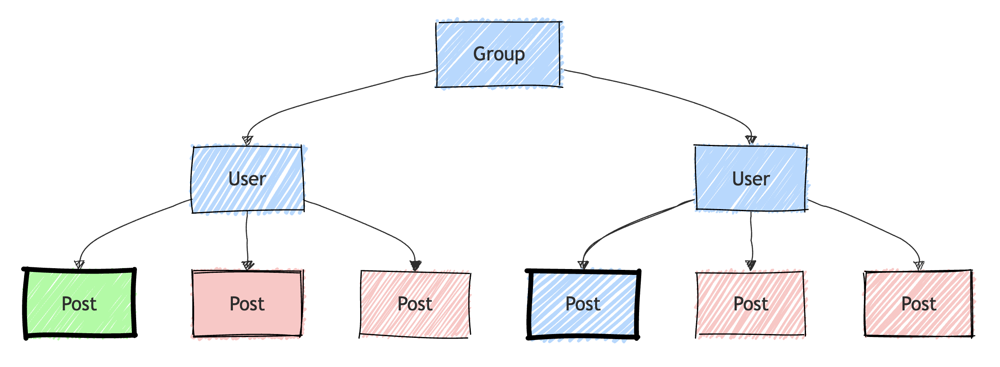
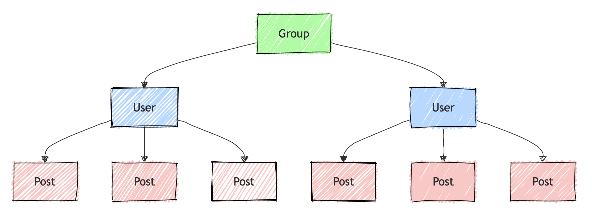
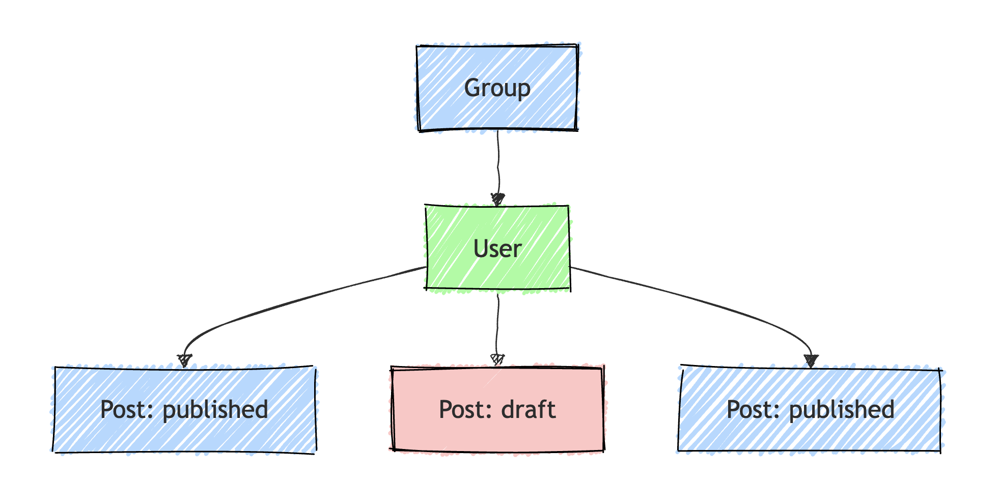
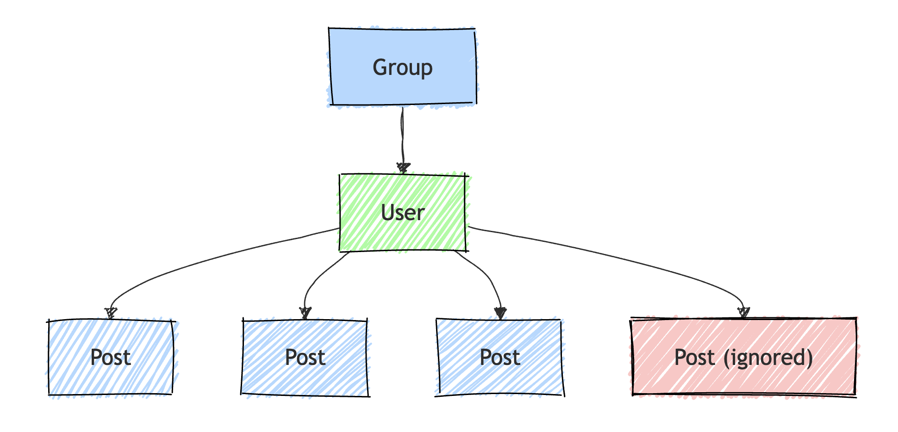
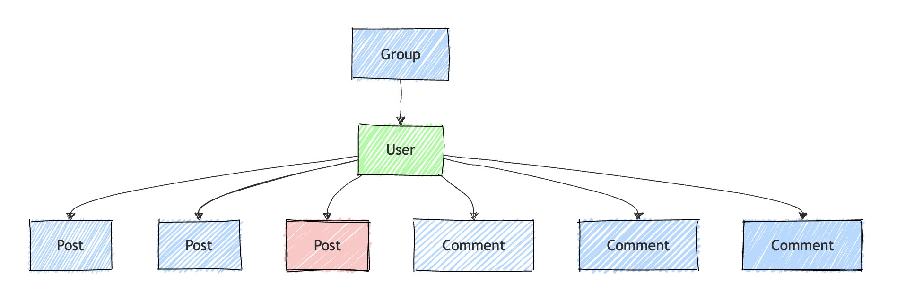

# Configuration

AliceGenerator provides a comprehensive set of configuration options to tailor fixture generation.

## Generator Setup

### Doctrine Integration

To integrate with Doctrine and leverage entity metadata and proxies:

```php
use Solitus0\AliceGenerator\Generator\FixtureGeneratorBuilder;
use Solitus0\AliceGenerator\MetadataHandler\DoctrineMetadataHandler;

$generator = FixtureGeneratorBuilder::create()
    ->setMetadataHandler(new DoctrineMetadataHandler($entityManager))
    ->build();
```

The `DoctrineMetadataHandler` automatically:
- Excludes identifiers and unmapped properties from fixtures
- Handles Doctrine proxy objects
- Uses Doctrine metadata to process mapped entities

## Naming Strategies

Customize property and reference naming for your fixtures.

### Property Namer

By default, fixture property names match object properties. To use a custom property namer:

```php
use Solitus0\AliceGenerator\Generator\FixtureGeneratorBuilder;
use App\Alice\Naming\CustomPropertyNamer;

$generator = FixtureGeneratorBuilder::create()
    ->setPropertyNamer(new CustomPropertyNamer())
    ->build();
```

The property namer runs before recursive traversal so the emitted name can guide write routing.
Object values passed to the namer have not yet been converted to fixture references.

### Reference Namer

Reference keys used in generated fixtures (e.g., `@User-1`) are created by a **Reference Namer**.
Each object gets one reference name per generation run. Repeated visits reuse that name.
If different objects request the same name, later objects receive an unused numeric suffix such as
`User-1-2`. Names reserved for skipped objects also stay reserved for the rest of the run.

You can configure a custom reference namer on the fixture generator builder:

---

#### Available Reference Namers

- **`ClassNamer`** *(default)*  
  Generates references based on the object's class name and a numeric index, with optional offset.

**Constructor:**
```php
public function __construct(int $referenceOffset = 0)
```

**Example:**
```php
use Solitus0\AliceGenerator\ReferenceNamer\ClassNamer;

// Creates references like @User-101, @Product-101
$namer = new ClassNamer(referenceOffset: 100);

$generator = FixtureGeneratorBuilder::create()
    ->setReferenceNamer($namer)
    ->build();
```
---

- **`CallbackNamer`**  
  Fully customizable reference generation via a user-provided closure, with optional offset.

**Constructor:**
```php
public function __construct(\Closure $callback, int $referenceOffset = 0)
```

**Example:**
```php
use Solitus0\AliceGenerator\ReferenceNamer\CallbackNamer;

// Creates references like @User-example@example.com
$namer = new CallbackNamer(
    callback: static function (object $obj, int $index): string {
        $short = (new \ReflectionClass($obj))->getShortName();
        if ($obj instanceof EmailAwareInterface) {
            return sprintf('%s-%s', $short, $obj->getEmail());
        }

        // Fallback: Short class name + index, e.g. "@User-1"
        return sprintf('%s-%d', $short, $index);
    }
);

$generator = FixtureGeneratorBuilder::create()
    ->setReferenceNamer($namer)
    ->build();
```

---
## Fixture generation context

### Skipping Non-Writable Properties

By default, the generator prefers constructor routing for constructor-backed private state, and otherwise falls back to normal Alice property assignment whenever Symfony's PropertyAccessor can write the value safely. That keeps constructor-only DTOs valid while preserving hydration order for regular setter-backed entities whose child fixtures depend on those values during graph construction.

For values that are not PropertyAccessor-writable, the generator tries these routes in order:
- matching constructor parameters are emitted under `__construct`
- matching public instance setters are emitted under `__calls`

If no safe property, constructor, or setter route can be derived, non-writable values are skipped during fixture generation.

If you want to include such properties, you can disable this behavior by setting the skipNonWritableProperties flag to false in the context:

```php
$context = FixtureGenerationContext::create()
    ->setSkipNonWritableProperties(false);
```

Example generated output:

```yaml
App\Security\ApiAuthentication\Entity\ApiKey:
    ApiKey-CommandRunner:
        __construct:
            - 'token'
            - 'command_runner'
            - ['ROLE_COMMAND_RUNNER']
        createdAt: '<(new \DateTime("2024-01-01 00:00:00", new \DateTimeZone("UTC")))>'
```

### Setter Fallback

If Alice needs to instantiate a class whose required constructor arguments are unavailable, opt in to constructor
bypass for that class when its setters can restore its state.

```php
$context = FixtureGenerationContext::create()
    ->allowConstructorBypassFor(SetterBackedRecord::class);
```

When generation falls back to setters for that class, Alice allocates the object without calling its constructor
and applies the emitted setter calls.

### Output Format

Fixtures are generated in YAML by default. To output PHP code or a custom format:

```php
use Solitus0\AliceGenerator\Generator\PhpGenerator;
use Solitus0\AliceGenerator\Generator\FixtureGeneratorBuilder;

$generator = FixtureGeneratorBuilder::create()
    ->setGenerator(new PhpGenerator())
    ->build();

$code = $generator->generate($objects, FixtureGenerationContext::create());
```

### Recursion Control

When traversal removes a value needed by a required constructor argument, generation omits the incomplete fixture
and fixtures that reference it. Classes configured for setter fallback can still be reconstructed when their setters
provide the required state.

### Legend

| Color / Style   | Meaning                | CSS Style           |
|-----------------|------------------------|---------------------|
| 🟩 Green        | Passed to generator    | `fill: #aaffaa`     |
| 🟦 Blue         | Included via traversal | `fill: #bbddff`     |
| 🟥 Red          | Excluded               | `fill: #ffcccc`     |
| ⬜ White         | Not visited            | `fill: #ffffff`     |
| 🔲 Thick border | Constrained            | `stroke-width: 4px` |

Limit how deep AliceGenerator traverses object graphs:

```php
$context->setMaximumRecursion(0);
```


```php
$context->setMaximumRecursion(1);
```


```php
$context->setMaximumRecursion(2);
```


Constrain generation to specific root objects:

```php
$context->addPersistedObjectConstraint($user);
```


```php
$context->addPersistedObjectConstraint([$post1, $post2]);
```


Each run groups the registered object identities using its configured metadata handler.
The same context can be reused with different handlers.

### Collection Handling

Collection options apply to Doctrine collection properties. Limits count selected items per collection
before recursion or other graph rules can prune them. Items excluded by a limit never reach the skip callbacks.

Skip entire collections for owner classes:

```php
$context->addOwnersWithSkippedCollections(User::class);
```


Skip individual items via a callback:

```php
$context->addCollectionItemSkipCondition(
    function (string $ownerClass, $item) {
        return $item instanceof Post && $item->isDraft();
    }
);
```


Limit the number of items in a collection:

```php
$context->addCollectionItemLimitPerOwner(User::class, 3);
```


```php
$context->addLimitForOwnerItemCollection(User::class, Post::class, 2);
```


## Custom Object Handlers

To support custom types (e.g., DateTime, UUIDs), see the [Custom Object Handlers](custom-object-handlers.md) guide.
