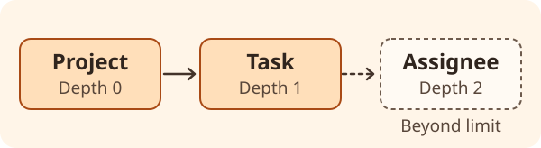

# Usage

Pass an object, an array of objects, or a Doctrine collection of objects to `generate()`. Use a
`FixtureGenerationContext` to control which related objects are included. Start with the [PHP example](getting-started.md#quick-start).

## Recursion and object constraints

Depth counts the number of relationships from the root. With `Project` as the root, a limit of `1` lets the
generator follow its relationship to `Task`. Increase the limit to `2` to reach `Assignee`.



```php
use Solitus0\AliceGenerator\Generator\FixtureGenerationContext;

$context = FixtureGenerationContext::create()
    ->setMaximumRecursion(1)
    ->addPersistedObjectConstraint($project);

$yaml = $generator->generate($project, $context);
```

- The default recursion limit is `5`. Previously discovered objects can still be referenced, including links
  back to the root.
- `addPersistedObjectConstraint()` accepts one object or an array. For each class you constrain, the supplied
  instances form an allowlist. Classes without a constraint remain eligible. Pass the actual object instances
  from the graph. The method does not query the database or compare primary keys.
- If a depth limit or constraint cuts off a value required by a constructor, the generator may omit the fixture
  and remove references to it. See [how fixtures are written](configuration.md#how-fixtures-are-written).

## Collection filters

These options apply to Doctrine collection properties handled by the built-in collection handler.
They do not apply to plain PHP arrays or collections passed directly to `generate()`.

| Context method | Effect |
| --- | --- |
| `addOwnersWithSkippedCollections(Project::class)` | Skip every collection property on that owner class. Pass an array to skip several classes. |
| `addCollectionItemLimitPerOwner(Project::class, 3)` | Keep up to three selected items per collection on that class. |
| `addLimitForOwnerItemCollection(Project::class, Task::class, 2)` | Keep up to two items of that class per collection. |
| `addCollectionItemSkipCondition($callback)` | Skip an item when the callback returns `true`. |

Owner and item class filters match exact classes. Limits accept zero or a positive integer and apply in collection
iteration order. Items rejected by a limit never reach the callback. Items rejected by a callback do not use
a slot. Items selected but later pruned during traversal still count toward the limit.

```php
use App\Entity\Project;
use App\Entity\Task;

$context->addCollectionItemSkipCondition(
    static fn (string $ownerClass, mixed $item): bool =>
        $ownerClass === Project::class && $item instanceof Task && $item->isDraft()
);
```
